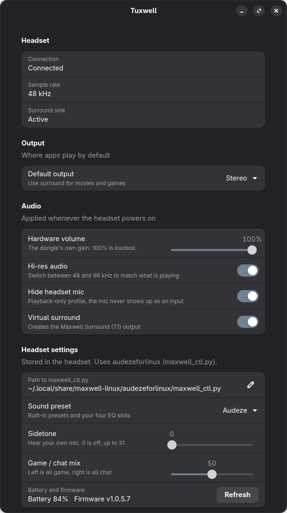

<div align="center">


# Tuxwell

**Get the most out of an Audeze Maxwell on Linux. Install once, then forget about it.**

[](https://github.com/omniscipotent/tuxwell/actions/workflows/ci.yml)
[](LICENSE)


</div>

The Audeze Maxwell works on Linux out of the box, but quietly, in stereo, locked to 48 kHz. **Tuxwell** fixes that
and does it only while the headset is powered on. Turn the headphones off and everything goes back to normal.

<p align="center"></p>

## What you get

| | |
|---|---|
| **Proper volume** | Sets the dongle's own hardware gain. It idles around -20 dB, which is why the headset feels quiet. |
| **Hi-res audio** | Lets PipeWire switch the dongle between 48 and 96 kHz, 24-bit, to match what plays (the dongle has no 44.1 kHz mode, so 44.1 material is converted to 48). It only switches when nothing else is playing at the old rate. |
| **Virtual 7.1 surround** | A *Tuxwell Surround (7.1)* output that renders 5.1/7.1 to your headphones using the SADIE II HRTF. |
| **Per-app surround** | Chosen apps (Plex HTPC by default) go to surround automatically, and the default output follows playback: surround while Plex plays, stereo when you pause, with one volume across both. |
| **Mic out of the way** | Optional playback-only profile, so the headset mic never gets picked as an input by mistake. |
| **Follows the headset** | Detects the headset powering on and off, even with the dongle always plugged in. |
| **Control panel** | A small GTK4 / libadwaita app with a tray icon (closing the window keeps it in the tray) for all of the above, plus the headset's sound preset (all 10: six built-in and four EQ slots), sidetone and game/chat mix. |

## Install

```bash
git clone https://github.com/omniscipotent/tuxwell
cd tuxwell

# Fedora (needed for surround). Other distros: your PipeWire "sofa" filter-chain plugin.
sudo dnf install pipewire-module-filter-chain-sofa

./install.sh            # user level, no sudo
```

Open **Tuxwell** from your app menu. Everything already works without it; the app is for occasional changes.

### Optional: headset settings (sound preset, sidetone, chat mix)

These live inside the headset and need two things:

1. Access to the headset's HID interface (one-time, needs sudo):
   ```bash
   sudo install -m644 udev/70-audeze-maxwell.rules /etc/udev/rules.d/
   sudo udevadm control --reload && sudo udevadm trigger --subsystem-match=hidraw --action=change
   ```
   then switch the headset off and on once.
2. [audezeforlinux](https://github.com/scotthowson/audezeforlinux), a separate project that speaks the headset's protocol:
   ```bash
   git clone --depth 1 https://github.com/scotthowson/audezeforlinux ~/.local/share/tuxwell/audezeforlinux
   ```
   The panel finds it there. Read its code first; it is not part of this project, and its firmware tool can write to your hardware.

## Configure

`~/.config/tuxwell/tuxwell.conf`

| Key | Default | Meaning |
|---|---|---|
| `HW_VOLUME` | `86` | Dongle gain, 0 to 96 (1 step = 1 dB, 96 = loudest) |
| `HIRES` | `1` | Allow 48 / 96 kHz switching |
| `DISABLE_MIC` | `1` | Playback-only card profile |
| `SURROUND_ENABLED` | `1` | Create the surround output |
| `SURROUND_GAIN` | `0.27` | Level of the surround mix (also a slider in the app). 0.27 was measured to make centred stereo exactly as loud through surround as through the stereo output. |
| `CENTER_DB` | `3` | Extra dB on the centre channel so 5.1 dialogue matches a stereo downmix. |
| `AUTO_DEFAULT` | `1` | The default output follows playback: surround while `PLAYING_APPS` plays, stereo when it pauses. Your volume is carried across each switch. |
| `PLAYING_APPS` | `plex-bin` | Regex for the player's own audio stream (not its menu sounds). |
| `SURROUND_APPS` | `tv.plex.PlexHTPC\|Plex HTPC` | Regex matched against each audio stream's properties. These apps play through surround. |

In Plex HTPC, set the audio speaker layout to 7.1 so it sends surround into the sink.
Find another app's identifiers with `pactl list sink-inputs` while it plays.

## How it works

A user systemd service (`tuxwell.service`) watches PipeWire for the Audeze sink. The dongle stays on the USB bus when the
headset powers off, but its audio sink disappears, so that is the signal. When it appears the service sets the hardware volume,
allows the extra sample rates, switches the card profile and starts the surround sink as a separate PipeWire client
(without restarting PipeWire). When it disappears everything is undone.

The surround sink is a PipeWire `filter-chain` with one `sofa` spatializer per speaker (ITU 7.1 positions) and the
[SADIE II](https://www.york.ac.uk/sadie-project/database.html) D1 HRTF (Apache-2.0), downloaded at install time and checked against a pinned SHA-256.

## Uninstall

```bash
./install.sh --uninstall
sudo rm -f /etc/udev/rules.d/70-audeze-maxwell.rules   # if you installed it
```

## Supported hardware

| | Status |
|---|---|
| Maxwell 2, Xbox dongle (`3329:4b28`) on Fedora 44 / GNOME / PipeWire | **Tested** |
| Other Maxwell 2 dongles, Maxwell (1), USB-C direct | Untested, help wanted |
| Other distros and desktops | Untested, help wanted |

This started as one person's setup and is meant to grow. See [docs/DEVICES.md](docs/DEVICES.md) for what is device- and distro-specific,
and [CONTRIBUTING.md](CONTRIBUTING.md) to help. If you try it, please run `tuxwell-report` and open a *Device / distro report* issue.

## Notes and limits

- Preset changes are sent as a USB control `SET_REPORT`. Sent as a plain `hidraw` write, a Maxwell 2 only accepts values 1 to 4 (as EQ slots) and ignores the built-ins. See [docs/PRESETS.md](docs/PRESETS.md).
- Surround only affects apps that send 5.1/7.1. Stereo content is not upmixed.
- No head tracking. See [maxwell-3d](https://github.com/TryCatch2022/maxwell-3d) if you have the Maxwell 2 ANC over USB-C.
- Not affiliated with Audeze. See [SECURITY.md](SECURITY.md) for exactly what this installs and touches.

## Related projects

[audezeforlinux](https://github.com/scotthowson/audezeforlinux) (headset protocol, EQ editor, firmware) ·
[maxwell-3d](https://github.com/TryCatch2022/maxwell-3d) · [MinsickHQ](https://github.com/blomstt/MinsickHQ)

## Credits

- Logo: based on Tux, the Linux mascot created by Larry Ewing using The GIMP. The artwork was generated with ChatGPT. See [assets/README.md](assets/README.md) for the terms.
- HRTF: SADIE II, University of York.

## License

[MIT](LICENSE)
